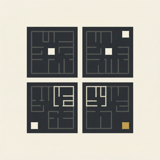

<div align="center">



# Connector

**Put a price on an ordinary HTTP app. Get paid per request, in tokens.**

_It terminates payments the way nginx terminates SSL._ One static binary reads one TOML
file, sits in front of your app, and settles on EVM and Solana.

[](https://github.com/toon-protocol/connector/releases)
[](https://github.com/toon-protocol/connector/actions/workflows/ci.yml)
[](LICENSE)
[](docs/guide/run-a-node.md#with-docker)
[](https://www.rust-lang.org)

[**Run a node**](docs/guide/run-a-node.md) · [**Put your app behind it**](docs/guide/put-your-app-behind-it.md) · [**Get paid**](docs/guide/get-paid.md) · [**Peer**](docs/guide/peering.md) · [**Operator surface**](docs/guide/operator-surface.md) · [**Guides**](#guides) · [**Contributing**](CONTRIBUTING.md)

```sh
docker pull ghcr.io/toon-protocol/connector:rust-2026.08.28.1
```

</div>

---

**A paid reverse proxy.** You put it in front of an ordinary HTTP app, you set a
price, and it collects that price from whoever calls — in tokens, per request,
without your app knowing payment exists.

```sh
docker pull ghcr.io/toon-protocol/connector:rust-2026.08.28.1   # a release handle, never moved
openssl rand -hex 32 > data/signer.key                          # the node's identity key
docker compose up -d                                            # one binary, one config file
curl http://localhost:3000/ilp                                  # ask the node what it is
```

[Run a node](docs/guide/run-a-node.md) has the `compose.yml` and the config those commands
need.

## Why it exists

It does that by being an [Interledger](https://interledger.org) connector: value
arrives wrapped in a protocol your app never speaks, and at the last hop this
binary unwraps it, verifies it was paid for, and hands the app a plain HTTP
request. **It terminates payments the way nginx terminates SSL.**

You do not need to know anything about Interledger to run one.

The work is split in two:

- An **app** is an ordinary HTTP service behind a route's `handler_url`. It receives an
  ordinary HTTP request, holds no key on your behalf, and never sees a payment.
- A **connector** sits in front of it. It opens the sealed payload, makes exactly that HTTP
  request of your app, and seals the app's complete response back.

It is built for an operator who is paid through it, so what it refuses is stated:

- **No app decides anything about a payment.** "The app answered" and "the packet was paid
  for" stay separable, so an app that knows nothing about payment cannot leak, forge or
  withhold one.
- **No route is silently free.** A terminated route must carry a `price`. Write `price = 0`
  if free is deliberate.
- **No key is a value.** Every key is a path. There are no inline keys, no mnemonic, and no
  environment-variable layer to smuggle one through.
- **No stale config loads quietly.** One TOML file is read once. An unknown key is a hard
  load failure, and a removed key is refused by name.
- **No bearer token moves value.** Reads take a bearer token. Writes take an RFC 9421
  signature from an ed25519 key on `write_keys`
  ([`operator-spec.md`](docs/protocol/operator-spec.md)).
- **No peering exists unless an operator created it.** It cannot be bought, learned or
  announced into existence.

## How it fits together

```
 one node: one static binary, one TOML file, one port
 ┌────────────────────────────────────────────────────────────────┐
 │  connector                                                     │
 │    route  g.example.quotes  ──►  app "quotes"  (plain HTTP)    │
 │    route  g.example.search  ──►  app "search"  (plain HTTP)    │
 │                                                                │
 │    settlement backends:  EVM, Solana  (x402 channels)          │
 └───────────────▲──────────────────────────────┬─────────────────┘
                 │  callers: a packet,          │  peerings: a fee
                 │  and a voucher for it        ▼  kept per packet
          anyone who pays the price     other operators' connectors
```

A **route** with a `handler_url` terminates at your app, and its `price` is what a caller
pays. A **settlement backend** is what lets anyone actually pay it: every channel is an x402
`batch-settlement` channel, on EVM or on Solana. A **peering** puts you on paths that start
somewhere else: you carry someone's packet one hop further, and keep a fee for doing it.
[`CONTEXT.md`](CONTEXT.md) is the full glossary.

## Four steps

|       | Step                                                           | You end up with                                     |
| ----- | -------------------------------------------------------------- | --------------------------------------------------- |
| **1** | [Run a node](docs/guide/run-a-node.md)                         | One binary, one config file, answering on a port.   |
| **2** | [Put your app behind it](docs/guide/put-your-app-behind-it.md) | Your app served through it, unchanged.              |
| **3** | [Get paid](docs/guide/get-paid.md)                             | A settlement chain, so anyone can pay what you ask. |
| **4** | [Peer with another node](docs/guide/peering.md)                | A path onward, and a packet that crosses it.        |

Then [the operator surface](docs/guide/operator-surface.md) for inspecting a node and
moving its money, and [operating it](docs/guide/operations.md) day to day.

## Guides

| Guide                                                             | What it walks through                                                                                                                 |
| ----------------------------------------------------------------- | ------------------------------------------------------------------------------------------------------------------------------------- |
| [1. Run a node](docs/guide/run-a-node.md)                         | The Docker image and its tags, a build from source, the config, routes and prices, and the self-description                           |
| [2. Put your app behind it](docs/guide/put-your-app-behind-it.md) | What your app receives, the `X-TOON-*` attribution headers, and what you can charge for                                               |
| [3. Get paid](docs/guide/get-paid.md)                             | The settlement tables for EVM and Solana, the devnet addresses, how a voucher is checked, how you get paid, and what you are trusting |
| [4. Peer with another node](docs/guide/peering.md)                | Being peerable, reading the other node's self-description, the three writes, and what to know before a real chain                     |
| [Try it locally](docs/guide/local-peering-lab.md)                 | Two connectors, one packet, one disposable chain: keys, funding, configs, peering, sending, and proving it was paid for               |
| [The operator surface](docs/guide/operator-surface.md)            | Read and write authority, every read and write endpoint, the dashboard, and signing a write                                           |
| [Operating it](docs/guide/operations.md)                          | Logs, releases, devnet and mainnet                                                                                                    |

## Reference

- [`docs/the-yellow-brick-road.md`](docs/the-yellow-brick-road.md): **The idea.** Why you
  pay a path and not a destination, and why the road earns the traffic.
- [`docs/rfcs/`](docs/rfcs/README.md): **The protocol.** Interledger, the ten vendored RFCs,
  and where TOON departs from each.
- [`docs/protocol/configuration-spec.md`](docs/protocol/configuration-spec.md): Every config
  key, and what each one binds.
- [`docs/protocol/operator-spec.md`](docs/protocol/operator-spec.md): The operator surface's
  rules, numbered.
- [`docs/protocol/self-description-spec.md`](docs/protocol/self-description-spec.md): What
  `GET /ilp` must and must not carry, rule by rule.
- [`docs/operators/x402-batch-settlement.md`](docs/operators/x402-batch-settlement.md):
  **Getting paid.** x402 channels end to end: the client's side, your keys, gas,
  facilitators, tokens.
- [`docs/operators/`](docs/operators/): Runbooks: box bring-up, key rotation, fleet release
  and health, signing a write, draining TOON channels.
- [`deploy/connector-rust/README.md`](deploy/connector-rust/README.md): The container path
  in full, including the image tag table.
- [`local/`](local/README.md): The shipped image against real chains — `make local-verify`.
- [`CONTEXT.md`](CONTEXT.md): The vocabulary. Read before writing docs or naming anything.
- [`docs/adr/`](docs/adr/README.md): Why any of this is the way it is. The tiebreaker for
  everything.
- [`CONTRIBUTING.md`](CONTRIBUTING.md): Building from source, the test gate, the chain
  binaries it needs.

## License

MIT — see [`LICENSE`](LICENSE). Except [`docs/rfcs/`](docs/rfcs/README.md), which
is CC BY-SA 4.0: it holds the Interledger Foundation's RFCs, reproduced
unmodified.
